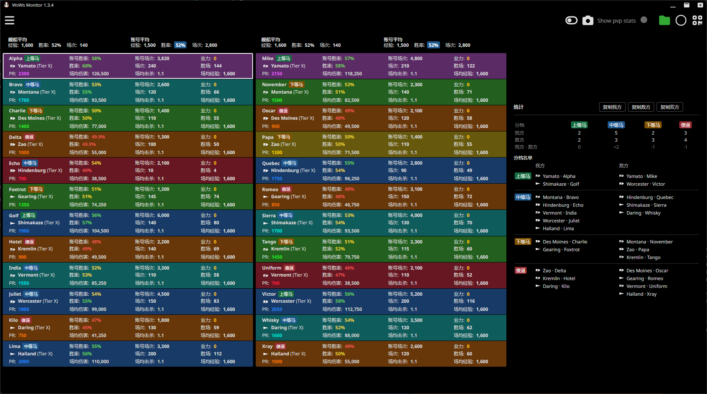
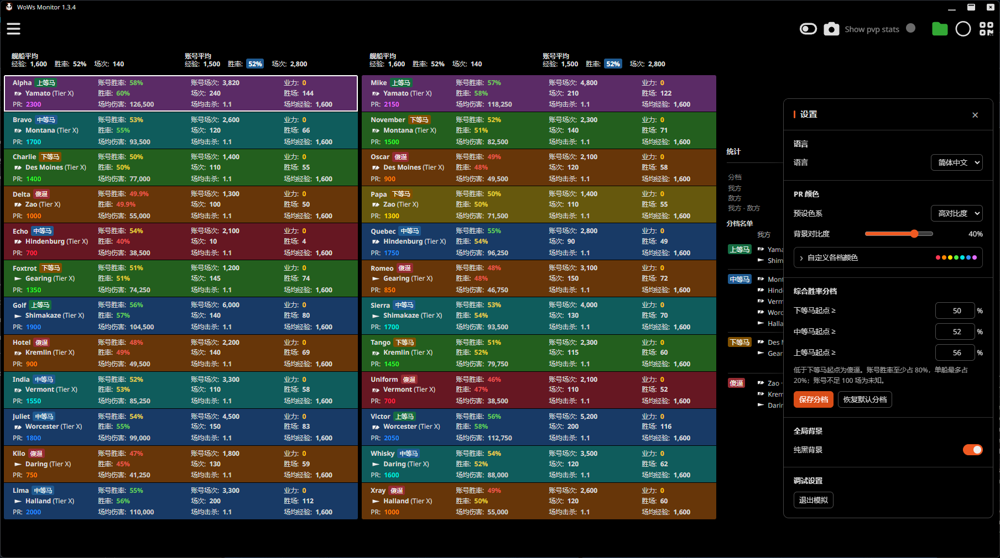

[简体中文](README.md) | [English](README.en.md)

# WoWs Monitor Enhanced

WoWs Monitor 的**非官方增强补丁**，面向 Windows 版 WoWs Monitor 1.3.4。原版由 stewie 开发，本项目与其或 Wargaming 没有官方关联：[WoWs Monitor 官网](https://wows-monitor.com/) · [原版下载](https://wows-monitor.com/downloads)。

本仓库不包含原版安装程序，也不提供原版后端服务。请先自行安装原版；增强版仍依赖原版的数据来源和正常运行状态。

## 功能

- PR 色系预设、逐档自定义、高对比度调节，以及可切换的全局纯黑背景。
- 基于账号和当前舰船胜率的玩家分档、舰种图标、双方统计、名单与复制。
- 适配宽屏的三栏界面，以及不进入游戏即可查看界面效果的模拟对局。
- 增强功能提供简体中文和 English 切换，并翻译对局页常用数据标签；原版自带的其他页面可能仍为英文。

分档默认采用账号胜率至少 80%、当前舰船胜率最多 20% 的加权值；单船不足 100 场时降低单船权重，账号不足 100 场或数据缺失时显示“未知”。它**只使用胜率和场次，不是综合 PR、伤害等指标的评分**。档位阈值可调整；“未知”不计入分档统计与复制名单。

舰种优先读取程序提供的数据，其次查找随补丁提供的资料快照；无法匹配的船显示 `?`。资料快照可能落后于游戏更新。资料来源见 [资源说明](NOTICE.md)。

以下为模拟对局截图，玩家名称和数据均为示例。





## 安装和恢复

### Windows 图形安装包（推荐）

从 [Releases](https://github.com/PrinzEugenn/WoWs-Monitor-Enhanced/releases) 下载 Windows x64 ZIP，完整解压后双击 `Install.cmd`。先完全退出 WoWs Monitor（包括托盘），确认或浏览选择原版安装目录，再点击“安装”；恢复原版时点击“恢复原版”。安装包自带 Node.js，无需另外安装。非默认安装目录可能需要相应写入权限。

### 手动安装


1. 安装[原版 WoWs Monitor 1.3.4](https://wows-monitor.com/downloads) 和 Node.js 18 或更新版本。
2. **完全退出 WoWs Monitor，包括系统托盘中的进程。** 下载本仓库，并在仓库目录打开 PowerShell。
3. 以下示例适用于默认安装位置；如果安装在其他目录，请替换路径。先检查兼容性：

   ```powershell
   node .\scripts\patch.js check "$env:LOCALAPPDATA\Programs\wows-monitor"
   ```

4. 检查通过后安装：

   ```powershell
   node .\scripts\patch.js install "$env:LOCALAPPDATA\Programs\wows-monitor"
   ```

5. 启动 WoWs Monitor。鼠标移至窗口右下角的齿轮可打开设置；在“语言”中切换简体中文或 English。“调试设置”中可开启模拟对局。

安装前会校验原版版本和关键文件的 SHA-256，并将原版 `resources/app.asar` 备份为同目录的 `app.asar.wows-enhanced.backup`。已有不同备份时不会覆盖。补丁会修改安装目录中的 `app.asar`；如果该目录需要管理员权限，请在有相应权限的 PowerShell 中操作。

需要恢复原版时，先完全退出程序，再执行：

```powershell
node .\scripts\patch.js restore "$env:LOCALAPPDATA\Programs\wows-monitor"
```

恢复过程会校验备份，并在当前程序没有增强补丁标记时拒绝覆盖；备份会保留。增强功能的设置保存在程序本地存储中，恢复原版不会自动删除它们。

**版本范围：**当前只支持关键文件与本项目校验值完全一致的原版 1.3.4。原版更新或其他补丁可能改变文件；检查失败时不要强行安装。原版自动更新也可能覆盖增强补丁，更新前请先恢复原版并重新检查兼容性。已经手动修改过的安装包不能直接作为补丁输入，请先恢复或重新安装受支持的原版。

## 验证与开发

需要自行提供受支持的原版 `app.asar`，不应将它提交到仓库：

```powershell
node .\tests\archive.test.js "C:\path\to\original\app.asar"
```

测试会在临时目录验证打包、备份、恢复和修改检测。项目也在隔离的模拟对局中检查过界面和语言切换；尚未对所有真实对局数据、游戏版本和显示布局完成验证。

运行不需要原版文件的核心逻辑测试：

```powershell
node .\tests\core.test.js
```

## 许可证和来源

原版 WoWs Monitor、舰种图标及第三方数据的权利分别属于相应权利人。本项目的原创代码和文档允许本地使用，但未经许可不得再分发，详见 [项目许可](LICENSE.md)。原版和第三方资源另受其各自条款约束，参见 [NOTICE.md](NOTICE.md)。请勿将本项目标示为官方版本。
